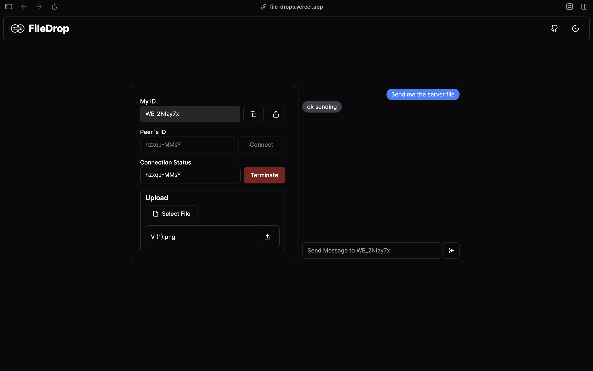

# FileDrop



FileDrop 是一个基于 WebRTC 的点对点文件传输与实时聊天应用。双方在浏览器之间建立 P2P 连接后，文件与消息直接在两端传输，业务服务器只负责在线状态与信令转发。

- 仓库地址：https://github.com/rick-peng-li/FileDrop-web.git
- 在线地址：https://file-drops.vercel.app/
- 前端：Vite 8 + React 19 + TypeScript 7 + Ant Design 6 + React Router 7
- 后端：Node.js 20 + Express 5 + Socket.IO 4
- 传输：WebRTC DataChannel（浏览器原生实现）+ Web Worker 分片合并

## 功能特性

- **P2P 文件传输**：通过 WebRTC DataChannel 直连传输，文件按 16KB 分片发送，带发送/接收进度。
- **实时聊天**：聊天消息复用同一条 DataChannel，不经过服务器转发。
- **在线状态校验**：发起连接前调用 REST 接口确认对端在线，减少无效连接。
- **分享链接与二维码**：复制 Peer ID、生成分享链接或扫码直接进入传输页。
- **一键接收**：对端发起呼叫时页面提示接受，连接建立后即可收发文件。
- **深浅色主题**：Ant Design 主题算法切换，偏好保存在本地。
- **响应式布局**：桌面与移动端自适应，无需注册登录。

## 技术架构

| 层 | 技术 | 说明 |
| --- | --- | --- |
| 构建工具 | Vite 8 | 开发服务器、HMR、生产构建 |
| 前端框架 | React 19、TypeScript 7 | 函数组件 + Hooks |
| 路由 | React Router 7 | `router/` 集中管理路由表 |
| UI 组件库 | Ant Design 6、@ant-design/icons | 主题、表单、进度、二维码等组件 |
| 实时通信 | Socket.IO 4 | 在线登记与信令转发 |
| P2P 传输 | WebRTC DataChannel | 文件与聊天数据直连 |
| 后台框架 | Express 5、Node.js 20 | REST 接口与静态响应 |
| 二进制处理 | Web Worker | 分片在后台线程合并为 Blob |
| 文件保存 | file-saver | 接收完成后触发下载 |

### 文件传输流程

1. 双方进入 `/transfer`，前端通过 Socket.IO 连接信令服务并登记 `uniqueId`。
2. 发起方输入对方 ID（或通过 `?code=` 分享链接自动带入），先请求 `GET /api/peers/:uniqueId` 校验在线。
3. 发起方创建 `RTCPeerConnection` 与 DataChannel，生成 Offer 后经 `send-signal` 转发给对端。
4. 对端在 `signaling` 事件中收到呼叫，点击接受后回传 Answer（`accept-signal` → `callAccepted`）。
5. 通道打开后，发送方发送文件元信息、二进制分片和结束标记；接收方把分片交给 Web Worker 合并。
6. 接收完成后生成 Blob，可保存到本地；聊天消息以 JSON 文本走同一通道。

## 目录结构

```
FileDrop-web
├── client/                          # 前端（Vite + React）
│   ├── index.html
│   ├── vite.config.ts               # Vite 配置与 @ 别名
│   ├── tsconfig.json
│   ├── public/                      # 静态图片
│   └── src/
│       ├── main.tsx                 # 应用入口
│       ├── App.tsx                  # 主题与路由装配
│       ├── router/index.tsx         # 路由表（/、/transfer）
│       ├── layouts/MainLayout.tsx   # 顶部导航 + 内容区布局
│       ├── pages/
│       │   ├── home/index.tsx       # 首页
│       │   └── transfer/index.tsx   # 传输页
│       ├── components/
│       │   ├── common/              # AppHeader、ThemeToggle
│       │   └── transfer/            # ConnectionCard、ChatPanel、上传/下载面板、分享弹窗
│       ├── hooks/usePeerTransfer.ts # WebRTC + Socket.IO 业务逻辑
│       ├── context/
│       │   ├── SocketProvider.tsx   # Socket 连接与用户 ID
│       │   └── ThemeProvider.tsx    # 主题与 Ant Design ConfigProvider
│       ├── utils/                   # 常量、类型、格式化、ID 生成、Worker
│       └── styles/global.css
├── server/                          # 后端（Express 5 + Socket.IO）
│   ├── index.js                     # HTTP + Socket.IO 启动入口
│   ├── app.js                       # Express 应用装配
│   ├── config/env.js                # 环境变量与端口
│   ├── routes/                      # 路由聚合与分组
│   ├── controllers/                 # 请求处理
│   ├── middleware/                  # 404 与错误处理
│   ├── models/                      # 在线用户、房间内存存储
│   └── socket/index.js              # Socket.IO 事件处理
├── .gitignore
├── LICENSE
└── README.md
```

## 页面说明

### 首页 `/`

产品定位介绍、连接提示与「Get Started」入口，顶部导航提供 GitHub 与主题切换。

### 传输页 `/transfer`

- **My ID**：当前用户的 10 位唯一 ID，可复制或生成分享链接与二维码。
- **Peer`s ID**：输入对方 ID 发起连接；URL 带 `?code=xxx` 时自动填充。
- **Connection Status**：展示当前连接状态与对端 ID，可主动断开。
- **Send a file**：选择文件后发送，显示发送进度与文件大小。
- **Received file**：接收中显示进度，完成后可下载。
- **Chat**：连接建立后可聊天，支持 `Ctrl/Cmd + K` 聚焦输入框、回车发送。
- **Incoming connection**：对端发起呼叫时出现接受按钮。

## 接口设计

### REST 接口（默认 `http://localhost:8000`）

| 方法 | 路径 | 说明 | 响应示例 |
| --- | --- | --- | --- |
| GET | `/` | 服务存活提示 | `hello from server` |
| GET | `/api/health` | 健康检查 | `{ "status": "ok", "uptime": 12.5, "timestamp": 1700000000000 }` |
| GET | `/api/stats` | 在线用户与活跃房间统计 | `{ "onlineUsers": 2, "activeRooms": 1 }` |
| GET | `/api/peers/:uniqueId` | 查询指定用户是否在线 | `{ "uniqueId": "Ab3dE9xYz1", "online": true }` |

路由定义见 `server/routes/`，处理逻辑见 `server/controllers/`。

### Socket.IO 事件

| 事件 | 方向 | 说明 |
| --- | --- | --- |
| `details` | 客户端 → 服务端 | 登记 `socketId` 与 `uniqueId` 映射 |
| `joinRoom` | 客户端 → 服务端 | 加入房间，服务端回 `ack` |
| `ack` | 服务端 → 客户端 | 加入房间确认 |
| `message` | 客户端 → 服务端 | 向房间广播消息（`roomMsg`） |
| `roomMsg` | 服务端 → 客户端 | 房间消息下发 |
| `send-signal` | 客户端 → 服务端 → 对端 | 转发 Offer / ICE 信令 |
| `signaling` | 服务端 → 客户端 | 对端收到呼叫信令 |
| `accept-signal` | 客户端 → 服务端 → 对端 | 转发 Answer 信令 |
| `callAccepted` | 服务端 → 客户端 | 呼叫被接受，建立 P2P 通道 |

## 环境变量

### 前端 `client`

| 变量 | 默认值 | 说明 |
| --- | --- | --- |
| `VITE_SOCKET_SERVER_URL` | `http://localhost:8000` | Socket.IO 与 REST 接口地址 |

需要自定义时在 `client` 下新建 `.env.local`：

```bash
VITE_SOCKET_SERVER_URL=http://localhost:8000
```

### 后端 `server`

| 变量 | 默认值 | 说明 |
| --- | --- | --- |
| `PORT` | `8000` | HTTP / Socket.IO 服务端口 |
| `CORS_ORIGIN` | `*` | 允许跨域来源，生产环境建议指定前端域名 |

需要自定义时在 `server` 下新建 `.env`：

```bash
PORT=8000
CORS_ORIGIN=http://localhost:5173
```

## 启动方式

### 环境要求

- Node.js 20.19 及以上
- npm 10 及以上

### 安装依赖

```bash
cd server && npm install
cd ../client && npm install
```

### 开发模式

```bash
# 终端一：启动后端（默认 8000 端口）
cd server
npm run dev

# 终端二：启动前端（默认 5173 端口）
cd client
npm run dev
```

浏览器访问 http://localhost:5173 。

### 生产构建

```bash
cd client
npm run build      # 产物输出到 client/dist
npm run preview    # 本地预览构建结果

cd ../server
npm start
```

### 使用步骤

1. 打开两个浏览器窗口，分别访问 http://localhost:5173/transfer 。
2. 复制窗口 A 的 **My ID**，填入窗口 B 的 **Peer`s ID** 并点击 **Connect**；也可以复制分享链接让 B 直接打开。
3. B 端点击接受呼叫，连接状态变为对端 ID。
4. 任一端选择文件并发送，另一端查看进度并下载；聊天面板可直接发消息。

> 跨网络传输需要可用的 TURN 服务，当前默认配置了公共 STUN/TURN，生产环境建议替换为自有 TURN。

## License

本项目基于 [MIT License](./LICENSE) 开源。
